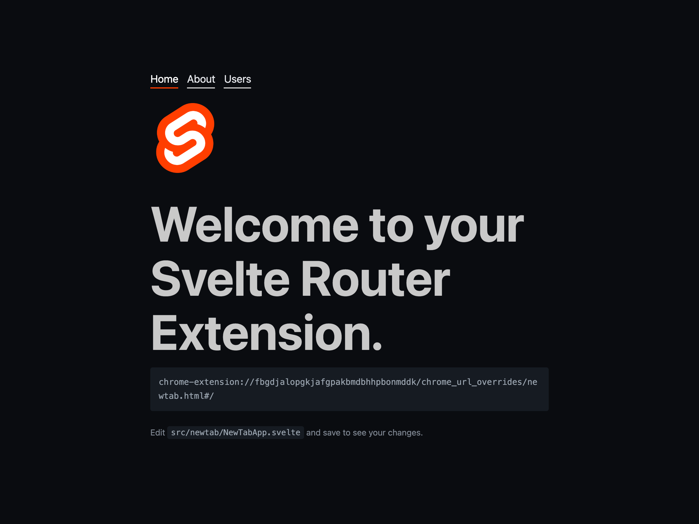

[powered-image]: https://img.shields.io/badge/Powered%20by-Extension.js-0971fe
[powered-url]: https://extension.js.org

![Powered by Extension.js][powered-image]

# Svelte Router New Tab Example

> Replaces your new tab page with a small Svelte app you can navigate across routes.



**What you'll see**: A custom new-tab page replacing the browser default.

**How it works**: The manifest overrides the new-tab page and loads a Svelte + TypeScript entry bundled from `src/newtab/`.

A new-tab page driven by [svelte-spa-router](https://github.com/ItalyPaleAle/svelte-spa-router). Routes live in the URL hash, so they work with no server and survive a reload. Useful for extension UIs that span multiple in-app routes.

svelte-spa-router publishes its components under the `svelte` export condition. `extension.config.js` adds that condition to the resolver so the build can find them.

## Try it locally

```bash
npx extension@latest create my-newtab-svelte-router --template newtab-svelte-router
cd my-newtab-svelte-router
npm install
npm run dev
```

A fresh browser window opens with the extension already loaded.

## Project layout

```
src/
├── images/
│   ├── icon-128.png
│   ├── icon-16.png
│   ├── icon-32.png
│   ├── icon-48.png
│   ├── icon-64.png
│   └── icon.png
├── newtab/
│   ├── routes/
│   │   ├── About.svelte
│   │   ├── Home.svelte
│   │   └── Users.svelte
│   ├── index.html
│   ├── NewTabApp.svelte
│   ├── Page.svelte
│   ├── scripts.ts
│   └── styles.css
├── background.js
└── manifest.json
```

## Commands

Cloned this repo instead? The examples ship without npm scripts, so run Extension.js directly from the example directory. Run `npm install` first when the example declares dependencies.

### dev

Run the extension in development mode. Target a browser with `--browser`:

```bash
npx extension@latest dev .                  # Chromium (default)
npx extension@latest dev . --browser=chrome
npx extension@latest dev . --browser=edge
npx extension@latest dev . --browser=firefox
```

### build

Build for production:

```bash
npx extension@latest build .                # Chromium (default)
npx extension@latest build . --browser=firefox
npx extension@latest build . --browser=edge
```

### preview

Preview the production build with the bundled browser:

```bash
npx extension@latest preview .
```

## Tests

This template ships an end-to-end check (`template.spec.ts`) validated by the examples-repo CI on every commit.

## Learn more

- [Extension.js docs](https://extension.js.org)
- [Templates index](https://extension.js.org/docs/getting-started/templates)
- [GitHub: extension-js/extension.js](https://github.com/extension-js/extension.js)
